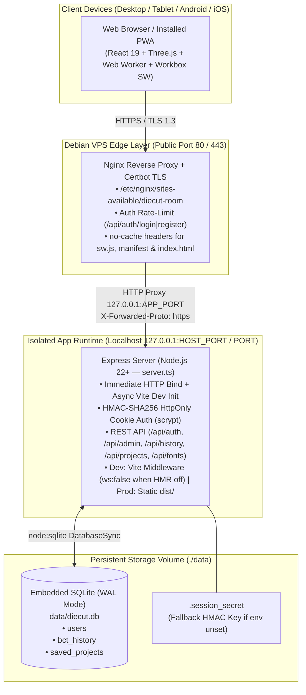
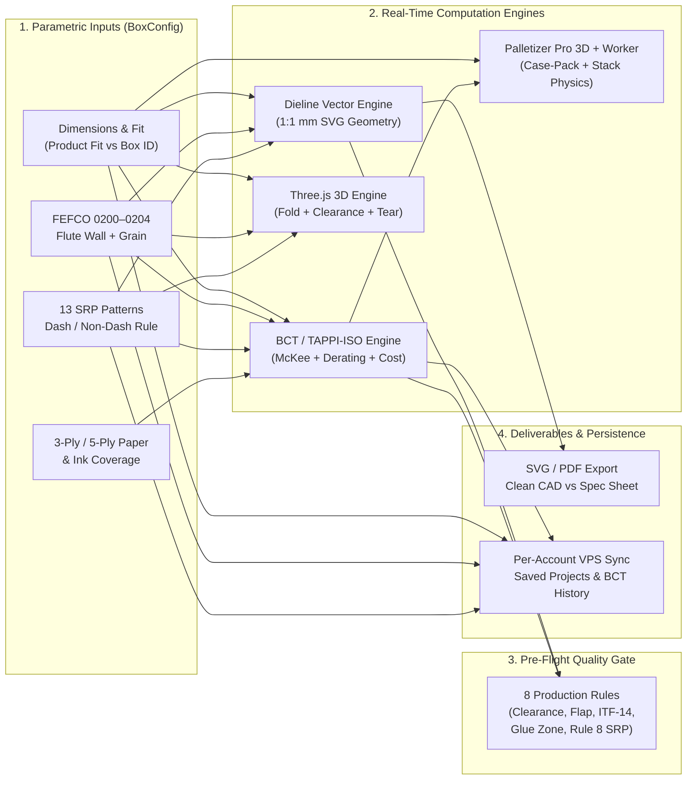
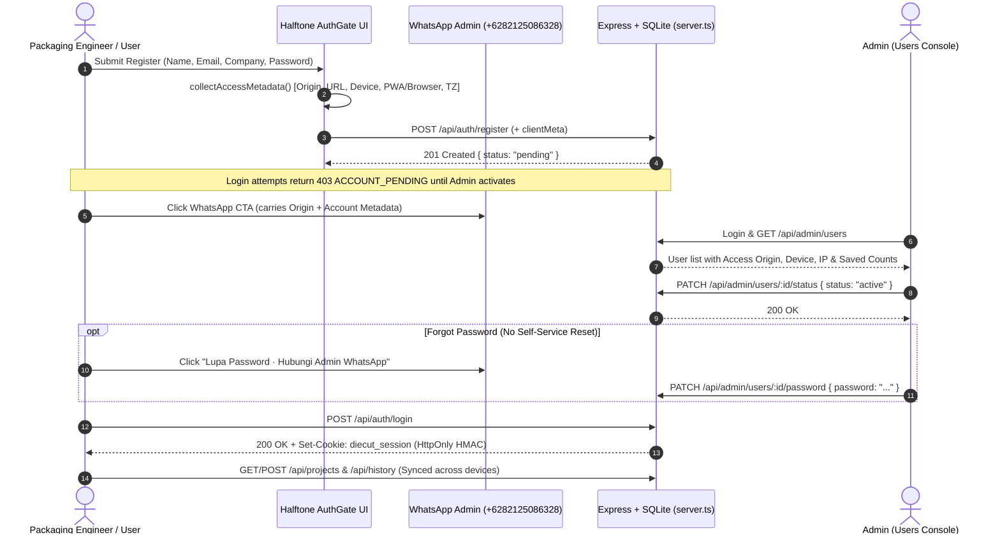
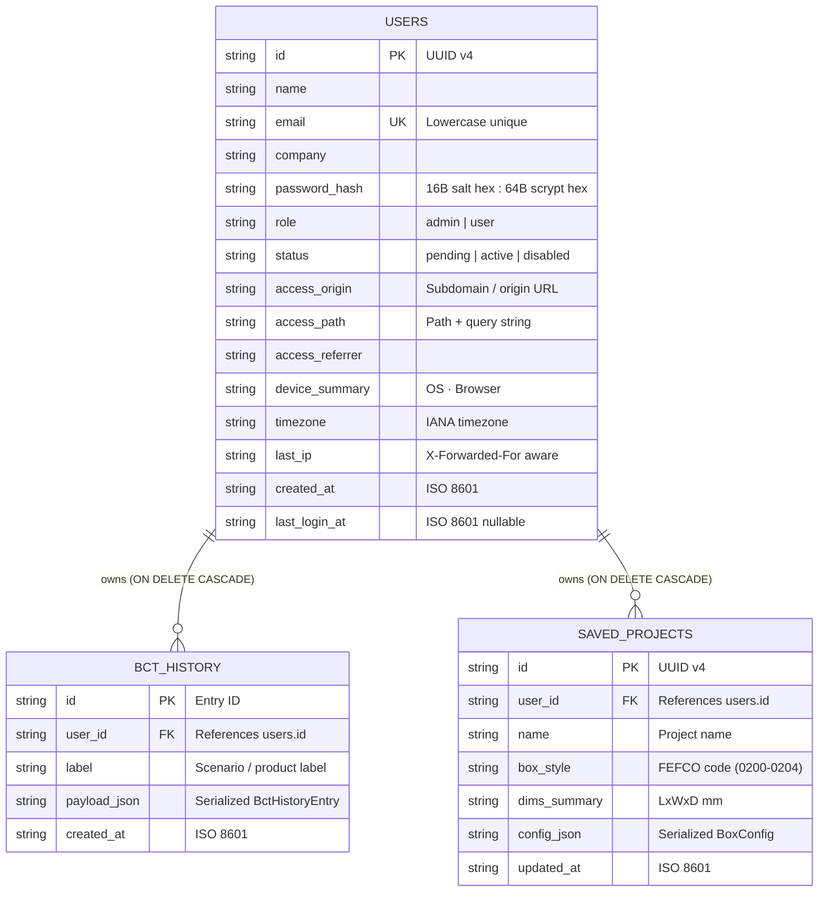

# DieCut.Room

<p align="left">
  
  
  
  
  
  
  
</p>

**DieCut.Room** is a private, self-hosted **Structural Packaging CAD**, **Interactive 3D Fit & Shelf-Ready Packaging (SRP) Tear Simulator**, **Palletizer Pro 3D Optimizer**, and **Box Compression Test (BCT Pro / TAPPI-ISO) Engineering Platform**. It runs as a lightweight full-stack monolith (**React 19 + Vite + Three.js + Web Worker + PWA** served by **Express + embedded Node.js 22 SQLite**) engineered for single-subdomain deployment on **Debian VPS** behind Nginx + Certbot TLS.

---

## Table of Contents

- [Core Capabilities](#-core-capabilities)
- [System & Infrastructure Architecture](#-system--infrastructure-architecture)
- [Codebase Architecture & Module Map](#-codebase-architecture--module-map)
- [End-to-End Engineering & CAD Pipeline](#-end-to-end-engineering--cad-pipeline)
- [Private Auth, Halftone Portal & WhatsApp Metadata Flow](#-private-auth-halftone-portal--whatsapp-metadata-flow)
- [Database Schema (Embedded SQLite WAL)](#-database-schema-embedded-sqlite-wal)
- [Environment Configuration: Moving from Preview to Debian VPS](#-environment-configuration-moving-from-preview-to-debian-vps)
- [Quick Start & Debian VPS Deployment](#-quick-start--debian-vps-deployment)
- [Typography Drop-In (Timeless Grotesk) & PWA Resilience](#-typography-drop-in-timeless-grotesk--pwa-resilience)
- [Complete Documentation Index](#-complete-documentation-index)

---

## Core Capabilities

| Domain | Capabilities |
| :--- | :--- |
| **Halftone Auth Portal & Admin Console** | Sharp-cornered matte offset-sheet login portal (`2px` radius) framed by perimeter halftone dots and static top-right raster gradient over an interactive dark matrix canvas. Self-registration starts in `pending` state until approved by Admin. Includes an in-app **Admin Users Console** to activate/disable accounts, inspect origin/device/IP metadata, override passwords directly, and permanently delete users (`ON DELETE CASCADE`). |
| **WhatsApp Verification + Metadata** | No self-service password reset. Login, Pending, and Disabled screens expose a **WhatsApp Admin CTA** (`+6282125086328`) pre-filled with origin subdomain, full URL, referrer, OS/browser summary, display mode (`Standalone PWA` vs `Web Browser`), screen size, and timezone. |
| **2D Dieline CAD (FEFCO 0200–0204)** | Generates true-scale **1:1 mm** vector dielines for `0201 (RSC)`, `0200 (HSC)`, `0202 (OSC)`, `0203 (FOL)`, and `0204 (CSSC)` with `Product Fit` anti-headspace presets, pre-press layers (*Bleed*, *Score Safe Zone*, *Glue Knockout*, *Flute Grain*), and GS1 **ITF-14** barcode with Modulo-10 auto-fix. |
| **13 SRP Patterns & Dash/Non-Dash Rules** | Includes 13 retail & logistics patterns (*Angled Hood*, *Drop-Front PDQ*, *Twin-Zipper*, *Split-Tray*, *Stepped Shelf-Tray + U-Scoop*, *Tear Strip*, *Carry Handles*, etc.) with **Solid Cut (Non-Dash)** vs **Perforation Rules** (`6/3`, `5/3`, `4/4 mm`, or custom `cut/tie`). |
| **3D Fit & Interactive SRP Tear Simulation** | Real-time Three.js WebGL simulator with `0–100%` box folding, X-Ray cavity clearance, top-right **POV Camera Capsule** (`Iso / Front / Top / Side`), top-left **SRP & Cavity Clearance HUD**, and `0–100%` interactive **Tear / Open SRP** opening animation. |
| **Palletizer Pro 3D & Smart Advisor** | Interactive 3D pallet stacking simulator (`ISO`, `EUR`, `US`, `Custom`) with **Case-Pack Solver**, pattern evaluation (*Interlock*, *Column*, *Pinwheel*, *Split*, *Hybrid*), friction/humidity load-retention physics, **Perfectionist Size Tuning**, and non-blocking **Web Worker** off-thread optimization. |
| **BCT Pro & TAPPI/ISO Audit Engine** | Single-Wall (`F/E/B/C/A`) and Double-Wall (`EB/BC/AB/AA`) compositions up to **K300**, **White Top Kraft**, **Testliner**, and **Semi-Chem** fluting; custom RCT overrides; per-panel ink **Print Coverage Simulator**; environmental derating; side-by-side **TAPPI vs. BCT Pro** comparison; 8 Pre-Flight rules with 1-click Auto-Fix; and batch costing. |
| **Multi-Viewport Ergonomics & Auto-Adaptive GPU** | 4-tier responsive workspace (`desktop ≥1280px`, `compact 1024–1279px`, `tablet 768–1023px`, `mobile <768px`) with auto-minimize panels, header close buttons, edge quick handles, **1-Click Focus Mode (`F`/`Esc`)**, Mobile Floating Thumb Dock, **Short-Landscape Floating HUD** (`height ≤ 500px`), `64px` compact sliders, lazy-loaded heavy views, and automatic GPU/CPU quality tiers (`ultra / balanced / eco / software`) with dynamic pixel-ratio scaling. |
| **Cross-Device Sync & Resilient PWA** | Saved dieline projects (`/api/projects`) and BCT snapshots (`/api/history`) sync per account in VPS SQLite (`data/diecut.db`) with Workbox `NetworkFirst` navigation, strict `/api/*` `NetworkOnly` isolation, self-healing boot watchdog, and optional runtime **Timeless Grotesk** font discovery (`/api/fonts/available`). |

---

## System & Infrastructure Architecture

**DieCut.Room** is engineered to coexist cleanly on a **Debian VPS** that already hosts other websites or reverse-proxied apps on ports `80/443`.



### Key Runtime Characteristics
- **Zero External DB Server**: Uses Node.js 22+ built-in `node:sqlite` (`DatabaseSync`) with `PRAGMA journal_mode = WAL` and `PRAGMA foreign_keys = ON`—no PostgreSQL/MySQL container or native C++ `node-gyp` compilation required.
- **Native TypeScript Execution**: Runs `node server.ts` directly in production via Node 22+ type stripping without a separate backend transpile step.
- **Fast Startup & Proxy-Aware Port Binding**: Binds `http.createServer` immediately for instant health-check readiness while initializing Vite dev middleware asynchronously (`ws: false` when HMR is disabled), and honors `NGINX_PORT`, `.env` `PORT`, or Docker `HOST_PORT` cleanly.

---

## Codebase Architecture & Module Map

| Layer | File | Responsibility |
| :--- | :--- | :--- |
| **Backend Server** | [`server.ts`](./server.ts) | Express + `http.createServer`, SQLite WAL bootstrap & initial Admin seeding, `scrypt` password hashing, HMAC-SHA256 cookie auth, Admin & sync endpoints, `/api/fonts/available` scanner, Vite dev middleware, and hardened production `dist/` static server. |
| **Domain Contracts** | [`src/types.ts`](./src/types.ts) | Canonical TypeScript interfaces for `BoxConfig`, FEFCO dimensions, 13 `PerforationOption` presets, `KRAFT/WHITE_TOP/TESTLINER/MEDIUM` specs, Palletizer types, `EngineeringAnalysis`, `AuthUser`, and `SavedBoxProject`. |
| **App Orchestrator** | [`src/App.tsx`](./src/App.tsx) | Session bootstrap (`/api/auth/me`), `AuthGate` guard, lazy-loaded 3D/Palletizer/Modal routes, dual-unit workspace state (`mm`/`in`), adaptive header + overflow menu, Mobile Thumb Dock, Focus Mode banner, and pre-flight drawer. |
| **Responsive Layout Hook** | [`src/hooks/useWorkspaceLayout.ts`](./src/hooks/useWorkspaceLayout.ts) | 4-tier responsive breakpoint detection (`desktop/compact/tablet/mobile`), `isShortLandscape` detection (`height ≤ 500 && width ≥ 560`), auto-minimize transitions, overlay mutual exclusion, and `F`/`Esc` shortcuts. |
| **Adaptive GPU Engine & Fonts** | [`src/utils/browserEngine.ts`](./src/utils/browserEngine.ts)<br/>[`src/utils/fontLoader.ts`](./src/utils/fontLoader.ts) | WebGL/CPU tier profiler (`ultra/balanced/eco/software`), dynamic DPR frame-cost controller, idle scheduler, and zero-404 runtime loader for licensed `Timeless Grotesk` `.woff2` files. |
| **2D Geometry Engine** | [`src/utils/dieline.ts`](./src/utils/dieline.ts) | Parametric CAD generator (`generateRSCDieline`) computing cut, crease, perforation, perforation-fold, bleed, score safe zone, glue knockout polygon, flute grain indicator, product fit rectangles, and GS1 ITF-14 coordinates. |
| **Engineering & Palletizer** | [`src/utils/engineering.ts`](./src/utils/engineering.ts)<br/>[`src/utils/palletizer.ts`](./src/utils/palletizer.ts)<br/>[`src/workers/palletizer.worker.ts`](./src/workers/palletizer.worker.ts) | Dual-engine BCT calculator (`TAPPI / ISO Calibrated` vs `BCT Pro Legacy`), panel ink crush, 8 Pre-Flight rules, blank waste/costing, Case-Pack solver, pallet physics optimization, and off-thread Web Worker advisor. |
| **2D CAD & 3D Simulators** | [`src/components/BoxPreview.tsx`](./src/components/BoxPreview.tsx)<br/>[`src/components/Box3DViewer.tsx`](./src/components/Box3DViewer.tsx)<br/>[`src/components/PalletizerWorkspace.tsx`](./src/components/PalletizerWorkspace.tsx) | Interactive zoom/pan SVG viewport + `1:1 mm` SVG/PDF export, Three.js Box Fit & `0–100%` SRP Tear viewer (top-right POV capsule + compact `64px` sliders + short-landscape floating bar), and interactive 3D Palletizer workspace. |
| **Config & Inspection UI** | [`src/components/Sidebar.tsx`](./src/components/Sidebar.tsx)<br/>[`src/components/BCTInspectorRail.tsx`](./src/components/BCTInspectorRail.tsx)<br/>[`src/components/EngineeringSheet.tsx`](./src/components/EngineeringSheet.tsx) | Collapsible left structural/pre-press/SRP configurator, right BCT inspector (`Calc`, `Audit`, `History`, `Compare`), and 8-rule Pre-Flight audit modal with 1-click Auto-Fix. |
| **Auth, Halftone & Sync UI** | [`src/components/AuthGate.tsx`](./src/components/AuthGate.tsx)<br/>[`src/components/HalftoneSheetDecor.tsx`](./src/components/HalftoneSheetDecor.tsx)<br/>[`src/components/InteractiveMatrixCanvas.tsx`](./src/components/InteractiveMatrixCanvas.tsx)<br/>[`src/components/AdminUsersModal.tsx`](./src/components/AdminUsersModal.tsx)<br/>[`src/components/ProjectsModal.tsx`](./src/components/ProjectsModal.tsx) | Halftone offset-sheet Login/Register/Pending/Disabled portal over interactive dot matrix canvas, Admin console, and per-account saved projects manager. |
| **WhatsApp, PWA & Design System** | [`src/utils/whatsapp.ts`](./src/utils/whatsapp.ts)<br/>[`src/components/WhatsAppContactButton.tsx`](./src/components/WhatsAppContactButton.tsx)<br/>[`src/components/PWAInstallControl.tsx`](./src/components/PWAInstallControl.tsx)<br/>[`src/components/tactile/TactileUI.tsx`](./src/components/tactile/TactileUI.tsx) | Origin/device/PWA metadata collector, `wa.me` deep-link builder, PWA install prompt (`beforeinstallprompt` + iOS sheet), offline badge, and light-mode tactile UI primitives. |
| **Deployment Config** | [`Dockerfile`](./Dockerfile), [`docker-compose.yml`](./docker-compose.yml), [`deploy/nginx-diecut.conf`](./deploy/nginx-diecut.conf) | Multi-runtime Docker build (`HOST_PORT` + `VITE_WHATSAPP_ADMIN` + `HEALTHCHECK`) and Debian Nginx TLS/PWA/auth-hardening virtual-host template. |

---

## End-to-End Engineering & CAD Pipeline



---

## Private Auth, Halftone Portal & WhatsApp Metadata Flow



---

## Database Schema (Embedded SQLite WAL)

All persistent application state lives inside a single WAL-mode SQLite file (`data/diecut.db`) initialized automatically on server boot.



---

## Environment Configuration: Moving from Preview to Debian VPS

When moving out of Preview onto your **Debian VPS**, configuration varies between **Docker Compose** and **Node.js 22 + PM2**, and whether port `3000` is already used by another app.

### 1. Variable Comparison Matrix (Preview vs. Debian Docker vs. Debian PM2)

| Variable | Preview | VPS — Multi-Stage Docker Slim (~160 MB) | VPS — Debian Node.js v22 + PM2 | Behavior & Notes |
| :--- | :--- | :--- | :--- | :--- |
| **`IMAGE_TAG`** | *Unused* | `1.5.0` *(pinned release tag)* | *Not used* | Pins Docker image tag (`diecut-room:${IMAGE_TAG}`) for deterministic tag-based rollback. |
| **`HOST_PORT`** | `3000` *(unused)* | `3000` *(or `3001` if `3000` is busy)* | *Not used* | Docker Compose binds `127.0.0.1:${HOST_PORT}:3000` on the Debian host. |
| **`PORT`** | Auto-resolved (`3000`) | `3000` *(fixed inside container)* | `3000` *(or `3001` if `3000` is busy)* | Express listen port. Keep `3000` inside Docker; change `PORT` directly in PM2 mode. |
| **`NODE_ENV`** | `development` | `production` | `production` | Serves optimized `dist/` bundle + PWA Service Worker instead of Vite dev middleware. |
| **`SQLITE_PATH`** | `./data/diecut.db` | **`/app/data/diecut.db`** | **`/opt/diecut-room/data/diecut.db`** | In Docker, host `./data` mounts to `/app/data`, so `SQLITE_PATH` **must** use `/app/data/...`. |
| **`SESSION_SECRET`** | Dev test secret | Fresh `openssl rand -hex 32` | Fresh `openssl rand -hex 32` | **Never reuse** preview secrets in production. Signs `diecut_session` HMAC cookies. |
| **`ADMIN_EMAIL`** | `totale.room@gmail.com` | Your Admin email | Your Admin email | Seeded once on first boot if no `'admin'` row exists yet. |
| **`ADMIN_INITIAL_PASSWORD`** | `DieCutAdmin2026!` | Strong unique production password | Strong unique production password | Used **only** when creating the initial Admin row on a fresh DB. |
| **`VITE_WHATSAPP_ADMIN`** | `6282125086328` | `6282125086328` *(no `+`)* | `6282125086328` *(no `+`)* | **Build-time variable**: baked into JS during `docker compose build` / `npm run build`. |
| **`TRUST_PROXY`** | `true` | `true` | `true` | Required so Express trusts Nginx's `X-Forwarded-Proto: https` & `X-Forwarded-For` headers. |

---

### 2. Production `.env` Templates (`/opt/diecut-room/.env`)

Generate a cryptographic secret on your Debian VPS:
```bash
openssl rand -hex 32
```

#### Option A — Debian Multi-Stage Docker Compose (`/opt/diecut-room/.env`)
```env
IMAGE_TAG=1.5.0
HOST_PORT=3000
PORT=3000
NODE_ENV=production
SQLITE_PATH=/app/data/diecut.db
SESSION_SECRET=replace_with_64_char_hex_from_openssl_rand
ADMIN_EMAIL=totale.room@gmail.com
ADMIN_INITIAL_PASSWORD=ReplaceWithStrongProdAdminPassword!
VITE_WHATSAPP_ADMIN=6282125086328
TRUST_PROXY=true
```

#### Option B — Debian Node.js v22 + PM2 (`/opt/diecut-room/.env`)
```env
PORT=3000
NODE_ENV=production
SQLITE_PATH=/opt/diecut-room/data/diecut.db
SESSION_SECRET=replace_with_64_char_hex_from_openssl_rand
ADMIN_EMAIL=totale.room@gmail.com
ADMIN_INITIAL_PASSWORD=ReplaceWithStrongProdAdminPassword!
VITE_WHATSAPP_ADMIN=6282125086328
TRUST_PROXY=true
```

> [!IMPORTANT]
> **Debian Bare-Metal (`NODE_ENV=production`) & Footprint Notes**:
> - In production (`NODE_ENV=production`), `server.ts` only loads `express`, `dotenv`, and built-in `node:sqlite`. The **Multi-Stage `Dockerfile`** separates frontend compilation (`builder`) from runtime (`runner`), yielding an **~160 MB** image with a **256 MB container memory limit** (`NODE_OPTIONS=--max-old-space-size=192`) and **~65–110 MB RSS** runtime usage.
> - On bare-metal PM2, always run `npm ci --include=dev` before `npm run lint && npm run build`, then optionally `npm prune --omit=dev && npm cache clean --force` to save disk. Debian 12 Bookworm's default APT `nodejs` is v18 (too old for `node:sqlite`); use **Docker Compose** or **Node.js v22 LTS** via NodeSource.

---

## Quick Start & Debian VPS Deployment

### Local Development
Requires **Node.js v22+** (`node:sqlite` and native `.ts` execution are built-in).

```bash
npm install
cp .env.example .env
npm run dev
```

Verify types and production build:
```bash
npm run lint    # tsc --noEmit
npm run build   # Vite + Workbox PWA bundle -> ./dist
```

### Debian VPS Production Deployment (Summary)
1. **DNS**: Point an `A` record for your subdomain (e.g., `cad.yourdomain.com`) to your Debian VPS public IPv4.
2. **Audit Existing VPS Services & Disk/RAM**: Check free disk/RAM (`df -h / && free -m`), occupied ports (`ss -tulpn`), and active Nginx sites (`/etc/nginx/sites-enabled/`) so existing apps/containers remain untouched.
3. **Configure `.env`**: Clone repo to `/opt/diecut-room`, create `.env` using Option A or B (`chmod 600 .env`), and ensure `data/` exists (`chmod 700 data`).
4. **Boot Runtime**:
   - **Docker Slim (Recommended when free disk ≥ 3 GB)**: `docker compose build --no-cache && docker compose up -d && docker builder prune -f`
   - **Node 22 + PM2 (Minimal disk)**: `npm ci --include=dev && npm run lint && npm run build && npm prune --omit=dev && NODE_ENV=production pm2 start server.ts --name diecut-room --interpreter node --max-memory-restart 220M`
5. **Debian Nginx (`sites-available`) + Certbot HTTPS**: Add `/etc/nginx/sites-available/diecut-room` from [`deploy/nginx-diecut.conf`](./deploy/nginx-diecut.conf), symlink to `sites-enabled/`, run `sudo nginx -t && sudo systemctl reload nginx`, and issue TLS via `sudo certbot --nginx -d cad.yourdomain.com`.

> **Deploying with an Autonomous AI Agent on Your Debian VPS?**  
> Point your VPS agent to [`AGENTS.md`](./AGENTS.md) and [`docs/05-AI-AGENT-VPS-RUNBOOK.md`](./docs/05-AI-AGENT-VPS-RUNBOOK.md) right after `git pull`.

---

## Typography Drop-In (Timeless Grotesk) & PWA Resilience

- **Timeless Grotesk Drop-In (`public/fonts/`)**: Place licensed `TimelessGrotesk.woff2` (or weight files `-Regular.woff2`, `-Medium.woff2`, `-SemiBold.woff2`, `-Bold.woff2`) inside [`public/fonts/`](./public/fonts/README.md) **before** `npm run build` / `docker compose build`. At runtime, `GET /api/fonts/available` discovers present files with zero 404 console errors when empty, falling back cleanly to `Plus Jakarta Sans` and `JetBrains Mono`.
- **Resilient Workbox PWA ([`vite.config.ts`](./vite.config.ts) + [`index.html`](./index.html))**:
  - Uses `NetworkFirst` for HTML navigations (`navigateFallback: null`), `CacheFirst` for immutable `/assets/*` bundles, and strict `NetworkOnly` for `/api/*`.
  - Production Express serves explicit `404` on missing `/assets/*` or `/fonts/*` files (never returning HTML masquerading as JS/CSS), paired with an `index.html` boot-recovery watchdog that auto-clears stale Service Workers if a module script ever fails after an update.
  - Nginx serves `/sw.js`, `/registerSW.js`, `/manifest.webmanifest`, and `/index.html` with `Cache-Control: no-cache, no-store, must-revalidate`.

---

## Complete Documentation Index

Detailed operational guides, engineering derivations, API contracts, and runbooks are maintained inside the repository (written in Indonesian for team & VPS operations):

| Document | Scope |
| :--- | :--- |
| **[`AGENTS.md`](./AGENTS.md)** | Mandatory root contract for Debian VPS AI Agents: multi-app coexistence rules, runtime decision matrix, Debian Node/Nginx checks, stop-gates, and Go-Live proof requirements. |
| **[`docs/01-USER-GUIDE.md`](./docs/01-USER-GUIDE.md)** | End-to-end User & Admin handbook: Halftone Login Gate, WhatsApp metadata, Admin Console, 2D FEFCO CAD, 13 SRP presets, 3D Fit & Tear simulator, Palletizer Pro 3D, Responsive Focus Mode/Landscape HUD, SVG/PDF export, and BCT Pro. |
| **[`docs/02-ENGINEERING-FORMULAS.md`](./docs/02-ENGINEERING-FORMULAS.md)** | Paper grade catalog (up to K300/White Top/Semi-Chem), TUF tables, TAPPI/ISO vs. BCT Pro ECT & McKee equations, panel ink crush math, 8 Pre-Flight rules, Palletizer case-pack/stability physics, and costing formulas. |
| **[`docs/03-VPS-SUBDOMAIN-DEPLOYMENT.md`](./docs/03-VPS-SUBDOMAIN-DEPLOYMENT.md)** | Manual Debian VPS setup: DNS `A` record, Docker Compose vs. PM2 (`npm ci --include=dev`), Debian Nginx `sites-available` + Certbot SSL, UFW firewall, PWA install, custom font drop-in, and SQLite backups (`sqlite3` & Node `VACUUM INTO`). |
| **[`docs/04-DEVELOPER-ARCHITECTURE.md`](./docs/04-DEVELOPER-ARCHITECTURE.md)** | Developer internals: system data flow, adaptive WebGL engine, responsive layout hook, SQLite WAL table schemas, cookie signing (`scrypt` + HMAC), Workbox routing, boot watchdog, and feature extension guides. |
| **[`docs/05-AI-AGENT-VPS-RUNBOOK.md`](./docs/05-AI-AGENT-VPS-RUNBOOK.md)** | Executable AI Agent runbook for Debian VPS after `git pull`: conflict audit, Node/Docker selection, `.env` & port isolation, Nginx `sites-available` + SSL setup, `curl` E2E smoke tests, backup cron, `git pull` update/rollback, and Go-Live checklist. |
| **[`docs/06-API-REFERENCE.md`](./docs/06-API-REFERENCE.md)** | Complete REST API contract (`/api/health`, `/api/fonts/available`, `/api/auth/*`, `/api/admin/users/*`, `/api/history/*`, `/api/projects/*`) with JSON payloads, error codes, and `curl` snippets. |
| **[`docs/07-TROUBLESHOOTING-AND-SECURITY.md`](./docs/07-TROUBLESHOOTING-AND-SECURITY.md)** | Day-2 operations: Admin recovery (`node:sqlite` + `scrypt`), Nginx rate-limiting (`limit_req`), Debian & production error matrix (`NODE_ENV=production`, Debian Node 18, cookies, Cloudflare, `SQLITE_READONLY`, PWA cache), and cross-VPS SQLite migration. |
| **[`docs/08-GITHUB-SETUP-AND-CHANGELOG.md`](./docs/08-GITHUB-SETUP-AND-CHANGELOG.md)** | GitHub push hygiene, read-only SSH Deploy Key setup for private repos, release tagging, and complete version changelog (`v1.0.0` – `v1.5.0`). |
