# Visual State Catalog — DieCut.Room (`Ground Truth` Lintas-Agent)

> **PERINGATAN UNTUK AI AGENT BERKEMAMPUAN VISION (ADE, Antigravity, Cursor, Claude Code, Codex, Vercel/v0, Lovable, Base44):**  
> Seluruh tangkapan layar pada dokumen ini adalah **render asli 100% dari aplikasi DieCut.Room yang berjalan** — bukan wireframe atau mockup generik. Saat membangun ulang, memodifikasi, atau menduplikasi aplikasi ini di lingkungan mana pun, **DILARANG mengganti tata letak, palet warna, radius sudut, tipografi, maupun susunan panel dengan gaya versi sendiri**. Gunakan katalog ini berdampingan dengan [`DESIGN.md`](../DESIGN.md), [`src/index.css`](../src/index.css), dan [`src/components/tactile/TactileUI.tsx`](../src/components/tactile/TactileUI.tsx).

## Cara Merekam Ulang Snapshot Secara Otomatis

Semua gambar PNG di folder [`docs/visual-snapshots/`](./visual-snapshots/) dihasilkan secara deterministik via Chromium *headless* tanpa dependensi npm tambahan (`Node.js 22+` native CDP):

```bash
# Pastikan server berjalan (mis. npm run dev di http://127.0.0.1:3000)
npm run snapshots:capture

# Verifikasi integritas katalog visual + seluruh paritas dokumentasi
npm run docs:check -- --strict
```

---

## Bagian 1 — Katalog Visual Desktop (`1440 × 900`)

### A. Gerbang Autentikasi (`AuthGate.tsx`) — Halftone Offset-Sheet (`2px` Radius)

*Invariant visual*: Kartu putih matte bersudut tajam `2px` di atas latar gelap interaktif `InteractiveMatrixCanvas`, dibingkai `HalftonePerimeterFrame` & `TopRightSheetHalftone`, dengan CTA WhatsApp Admin ber-metadata dan logo resmi **Totale.Room** (`public/assets/aistudio/Asset_2_5ca58983.svg`).

#### 1. Login Portal (`view === 'form'`, `tab === 'login'`)
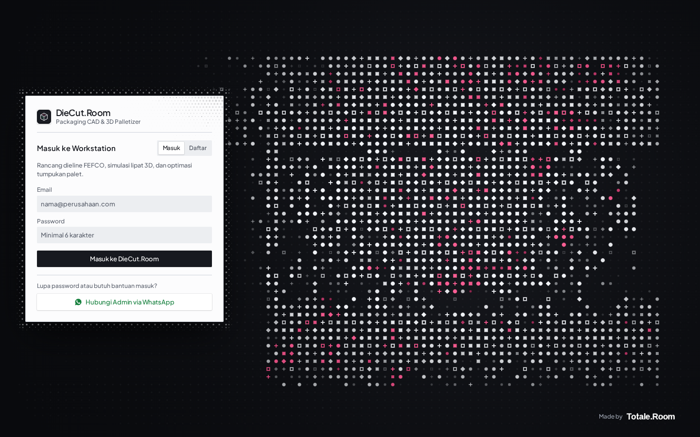

#### 2. Pendaftaran Akun (`view === 'form'`, `tab === 'register'`)
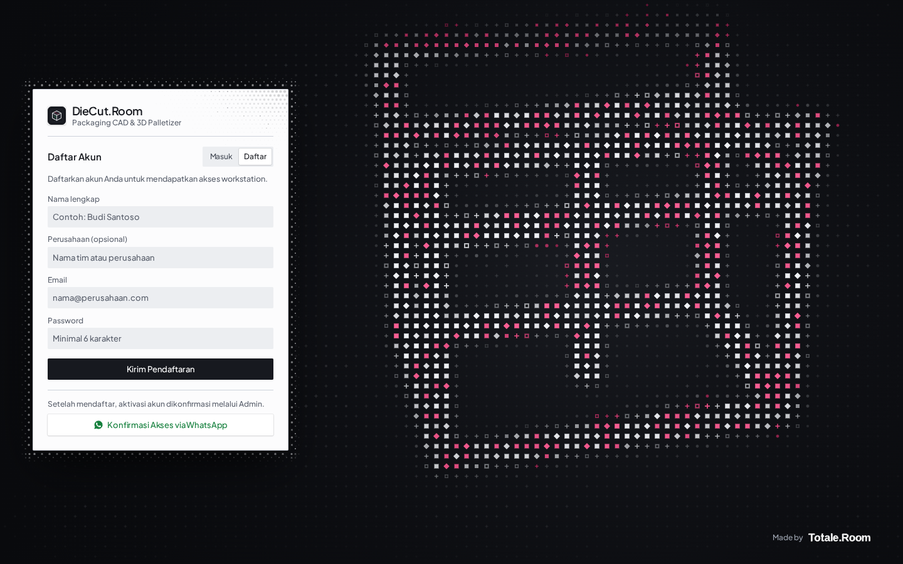

#### 3. Pemulihan Darurat Admin Tersembunyi (`view === 'admin-recover'`)
*Pemicu*: Pintasan `Alt+Shift+R` / `Ctrl+Shift+Alt+A` atau ketuk logo 5× dalam 2,5 detik. Menyediakan tab **Recovery Key** & **SMTP Email OTP** (dengan *cooldown* 60 detik).
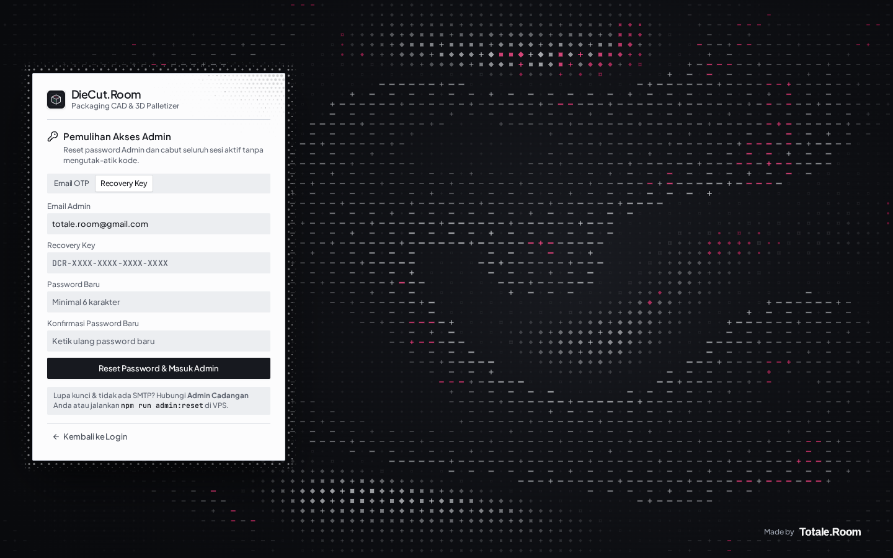

> **State Non-Interaktif Tambahan di `AuthGate.tsx`**:
> - `view === 'pending'` (*Pending Approval*): Muncul setelah pendaftaran baru atau saat login akun berstatus `pending` (`403 ACCOUNT_PENDING`), menampilkan tombol verifikasi WhatsApp Admin ber-metadata.
> - `view === 'disabled'` (*Account Disabled*): Muncul untuk akun berstatus `disabled` (`403 ACCOUNT_DISABLED`).
> - **Brute-Force Account Lockout Banner**: Muncul di form login saat `failed_login_count` melampaui batas dan `locked_until` aktif (`429 ACCOUNT_LOCKED`).

---

### B. Ruang Kerja Utama — 2D Die-Line CAD & Panel Specs (3 Tab)

*Invariant visual*: Layout studio 3 kolom presisi (**Specs Rail** kiri + **Kanvas CAD/3D** tengah + **BCT Pro Rail** kanan) di atas kanvas `--ground: #F4F5F7`, header kompak dengan switcher `2D / 3D / Pallet`, tombol `Projects`, `Pre-Flight`, `Admin`, `Focus Mode (F)`, serta footer teknis bersih.

#### 4. Kanvas 2D Die-Line CAD + Specs (`Structure`) + BCT Pro (`Calc`)
Menampilkan FEFCO `0200–0204`, switcher 3 unit (`mm` / `cm` / `in`), mode `Direct ID` vs `Product fit`, komposisi papan single/double-wall, dan ekspor 1:1 mm (SVG/PDF).
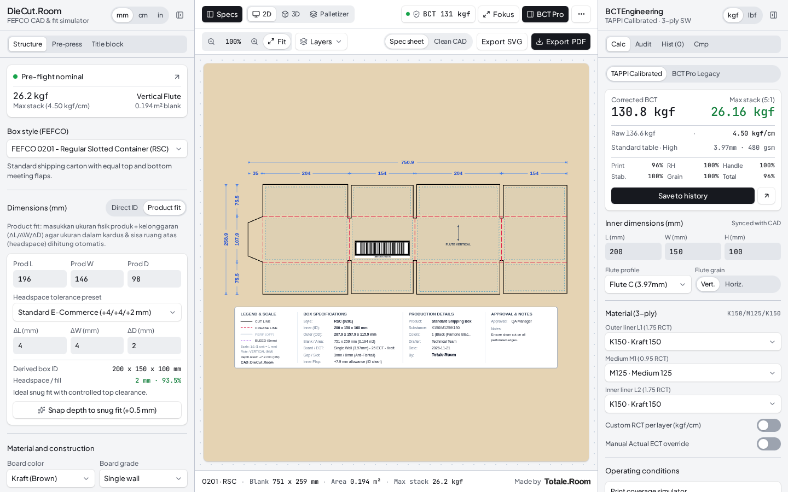

#### 5. Panel Specs — Tab `Pre-press` (Print Boundaries & 13 Pola SRP Perforation Aktif)
Menampilkan kontrol *Print bleed*, *Score safe zone*, *Flute grain direction*, *Glue flap no-ink zone*, serta switch aktif *Perforation and cutouts* (13 pola SRP supermarket & aturan *dash/non-dash*).
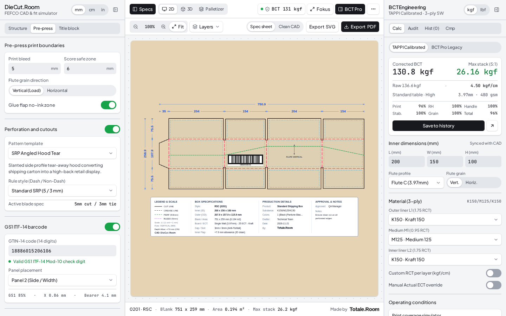

#### 6. Panel Specs — Tab `Title block` (Metadata Gambar Teknik & Revisi)
Menampilkan blok identitas gambar (*Drawing title*, *Client*, *Part/SKU*, *Revision*, *ITF-14 barcode*, dan catatan produksi).
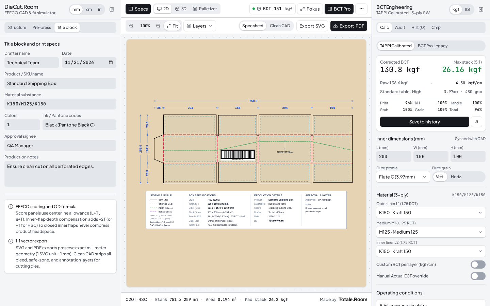

---

### C. Simulator 3D Fit & Interactive SRP Tear (`Box3DViewer.tsx`)

*Invariant visual*: Viewport WebGL Three.js adaptif (`browserEngine.ts`), kapsul kamera POV kanan-atas (`Iso / Front / Top / Side`), HUD *Clearance & SRP* kiri-atas, serta *control bar* bawah (`Flat / Open / Closed`, slider lipat `64px`, tombol `Peel/Reset`, tombol `X-Ray`).

#### 7. 3D Fit & Tear — Karton Terlipat & X-Ray Cavity
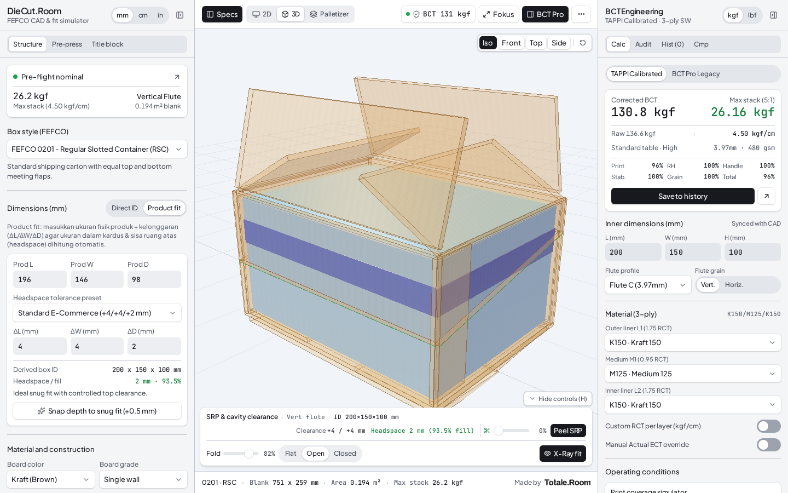

#### 8. 3D Fit & Tear — Simulasi Sobekan SRP Supermarket Aktif (`Peel 100%`)
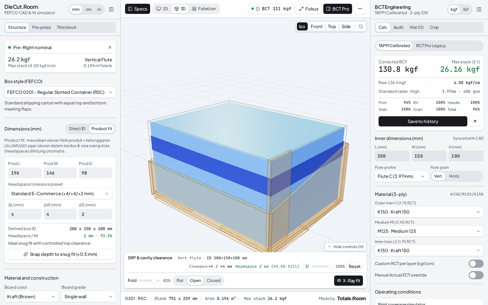

> **State Pemulihan WebGL**: Apabila konteks WebGL terputus oleh GPU sistem (`webglcontextlost`), `Box3DViewer.tsx` menampilkan *recovery overlay* khusus dengan tombol muat ulang viewport tanpa merusak konfigurasi CAD.

---

### D. Palletizer Pro 3D & Laporan Engineering PDF A4 (`PalletizerWorkspace.tsx`)

*Invariant visual*: Panel konfigurasi palet kiri (`ISO / EUR / US / Custom`, Case-Pack Solver, pola *Interlock/Column/Pinwheel/Split/Hybrid*, *Perfectionist Tuning* & *Board Advice*), viewport 3D tumpukan palet tengah, serta bilah aksi `Export PDF`, slider `Inspect Layer`, `Heat-Map`, dan `X-Ray`.

#### 9. Palletizer Pro 3D — Tampilan Normal Stack & Efficiency HUD
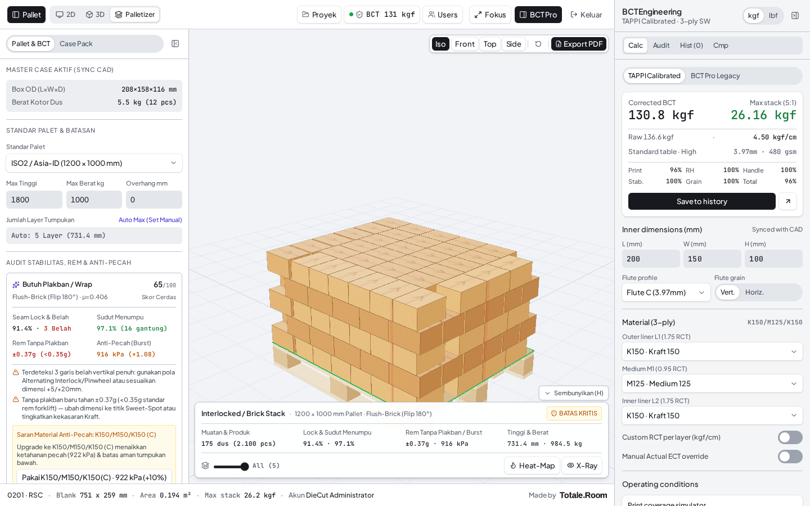

#### 10. Palletizer Pro 3D — Mode `Lock Heat-Map` & Mini-Blueprint Overlap Layer 1 vs Layer 2
Menampilkan pewarnaan status penguncian antar-layer (hijau = terkunci kuat, kuning = kolom 1:1 / marginal, merah = sudut tak tertopang / *fault line*) serta mini-blueprint overlap L1 vs L2 di sudut viewport.
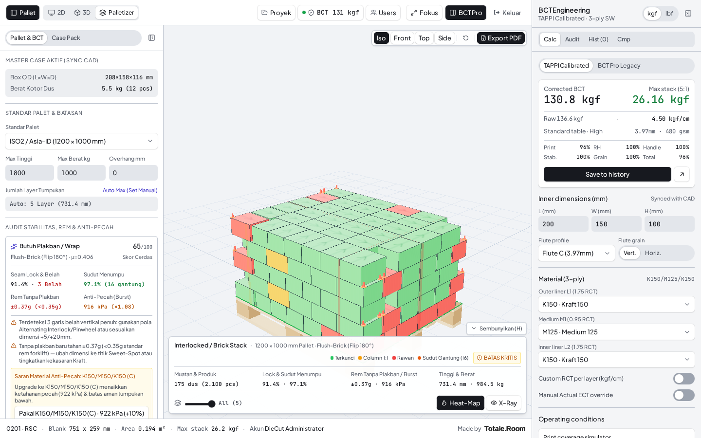

#### 11. Palletizer Pro 3D — Mode `Inspect Layer` (Irisan Layer Tunggal)
Menampilkan isolasi tumpukan hingga layer spesifik (mis. `Lyr 2/N`) untuk verifikasi orientasi per tingkat.
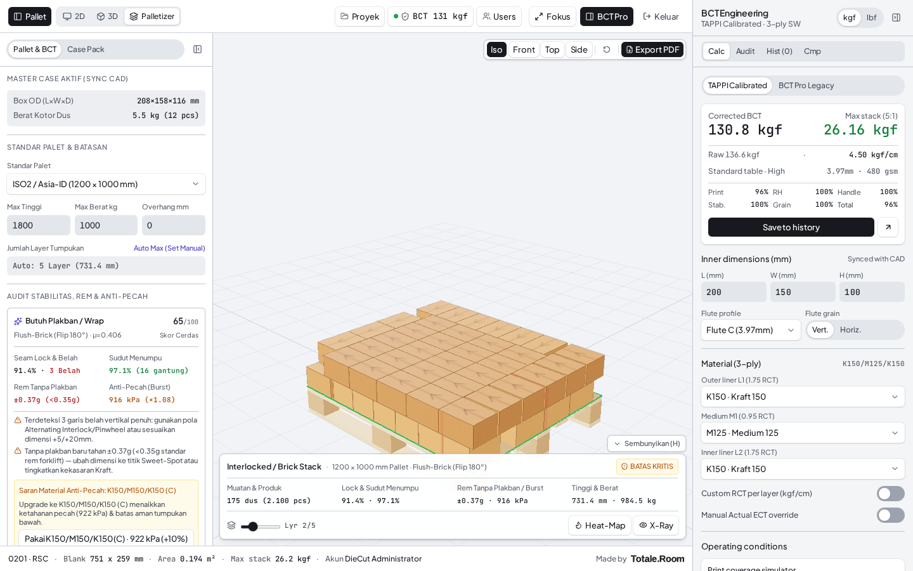

#### 12. Modal Export Laporan Engineering PDF A4 (2 Halaman Orthographic)
Menampilkan pratinjau struktur 2 halaman A4 (Halaman 1: spesifikasi & Case-Pack; Halaman 2: 4 POV Orthographic normal ber-kontras orientasi `0°/90°` + dimensi vektor `L×W×T` + panel Heat-Map Iso/Top + panduan 2D Layer 1 & Layer 2 bernomor) bergaya **Precision Tactile Studio** dengan header kiri *DieCut.Room* dan logo kanan *Totale.Room*.
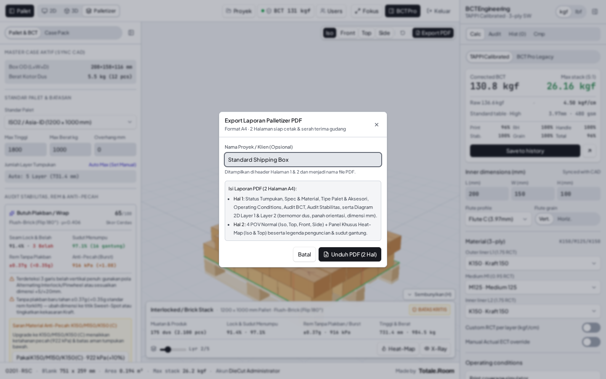

---

### E. BCT Pro Structural Inspector Rail (`BCTInspectorRail.tsx` — 4 Sub-Tab)

*Catatan*: Tab 1 (`Calc`) terlihat pada gambar `04-workspace-2d-specs-structure.png` (menampilkan pilihan mesin `TAPPI/ISO` vs `BCT Pro`, switcher satuan `kgf/lbf`, McKee 1963, 5 faktor koreksi lingkungan, dan status keamanan tumpukan).

#### 13. BCT Pro Rail — Tab `Audit` (Diagnostik Struktural & Board Upgrade Advisor)
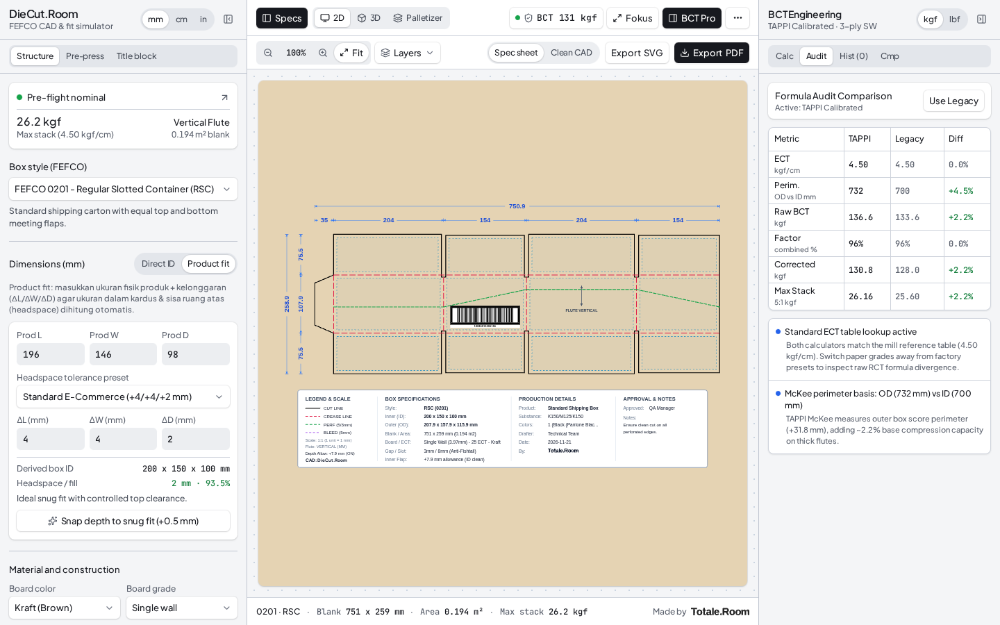

#### 14. BCT Pro Rail — Tab `Hist` (Riwayat Skenario BCT Tersimpan di SQLite)
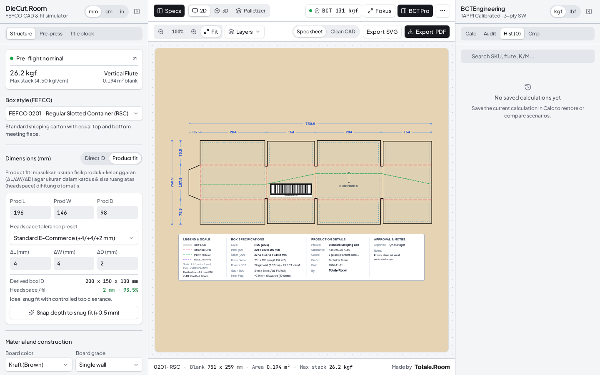

#### 15. BCT Pro Rail — Tab `Cmp` (Matriks Perbandingan Lintas Grade & Flute)
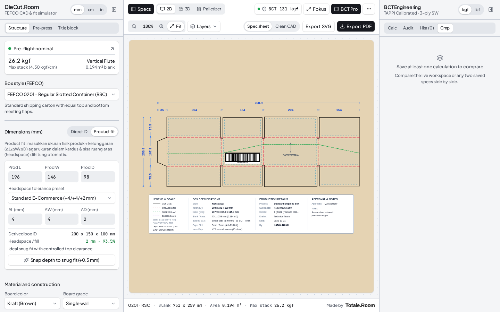

---

### F. Modal Operasional & Konsol Admin 4-Tab

#### 16. Pre-Flight Engineering Sheet Modal (`EngineeringSheet.tsx`)
Menampilkan audit kualitas 8 aturan produksi CAD + tombol 1-klik *Auto-Fix* + kalkulasi biaya/limbah lembaran.
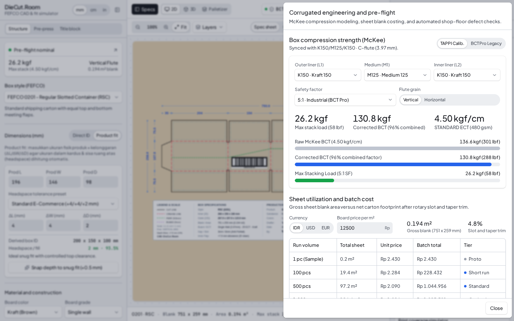

#### 17. Saved Box Projects Modal (`ProjectsModal.tsx`)
Menampilkan manajemen proyek box per-akun (`Simpan`, `Muat`, `Hapus`, serta *empty state* bersih jika belum ada proyek).
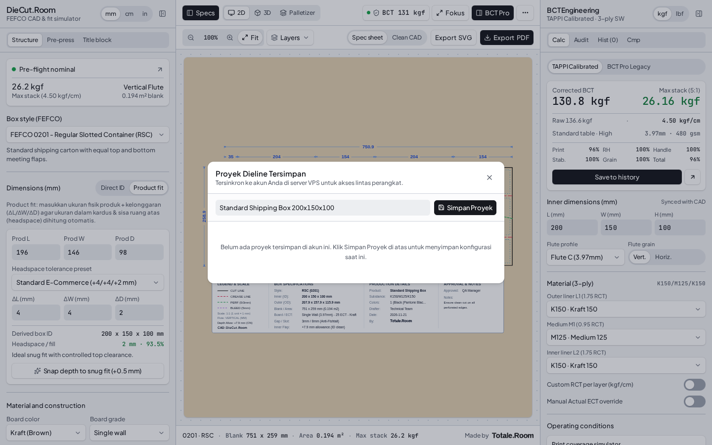

#### 18. Admin Console — Tab 1: `Pengguna & Sesi` (`AdminUsersModal.tsx`)
Menampilkan ringkasan status akun (`active/pending/disabled`), pembuatan akun baru, edit profil/peran, aktivasi massal (*Bulk Approve Pending*), reset password, pencabutan sesi (`Revoke`), dan metadata akses asal.
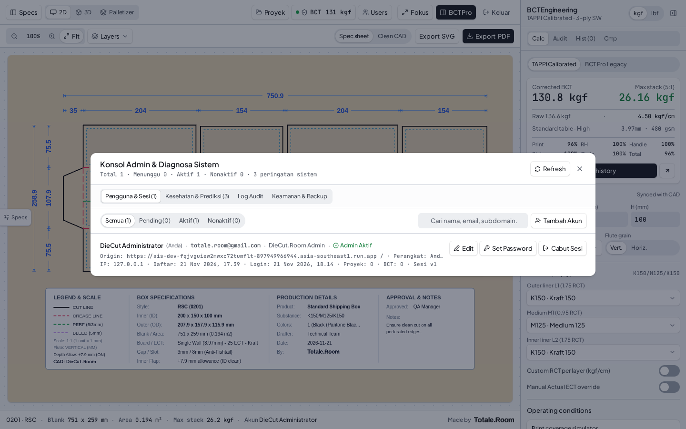

#### 19. Admin Console — Tab 2: `Kesehatan & Prediksi` (*Health Radar*)
Menampilkan pemantauan RAM RSS vs batas container, ukuran database SQLite WAL, *uptime*, dan peringatan prediktif keamanan/kapasitas.
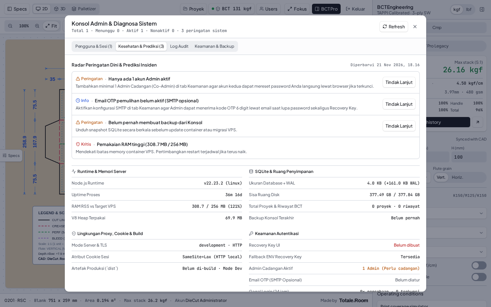

#### 20. Admin Console — Tab 3: `Log Audit`
Menampilkan linimasa kejadian keamanan terfilter (*auth*, *admin*, *security*, *backup*) lengkap dengan tingkat keparahan (`info/warn/critical`), aktor, target, dan IP.
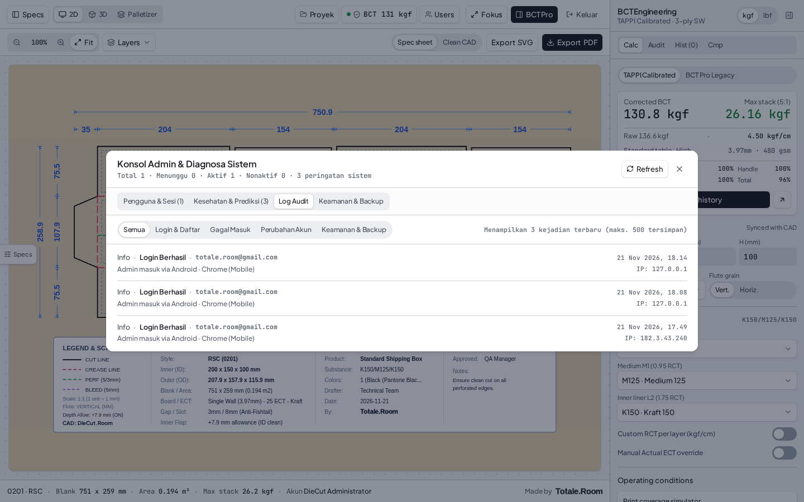

#### 21. Admin Console — Tab 4: `Keamanan & Backup`
Menampilkan ganti sandi Admin, rotasi *Admin Recovery Key*, konfigurasi & uji **SMTP Email OTP**, penerbitan/rotasi kunci **Hermes Agent REST / MCP** (`X-Agent-Key`), serta unduh *backup* langsung **SQLite `.db`** dan **JSON**.
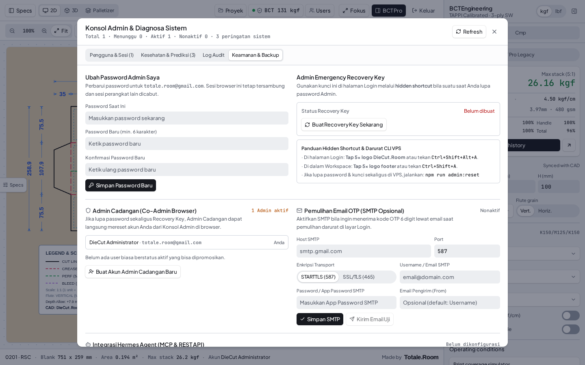

---

## Bagian 2 — Katalog Visual Mobile Core (`390 × 844`)

*Invariant responsif (`useWorkspaceLayout.ts`)*: Pada viewport `< 768px`, panel kiri (*Specs*/*Pallet*) dan kanan (*BCT Pro*) berubah menjadi *slide-over drawer* terpisah agar kanvas tetap maksimal, dikendalikan lewat **Mobile Floating Thumb Dock** di sisi bawah serta menu overflow ringkas di header.

| Layar Inti Mobile | Tangkapan Layar (`390 × 844`) |
| :--- | :--- |
| **M1. Mobile Auth Portal** | 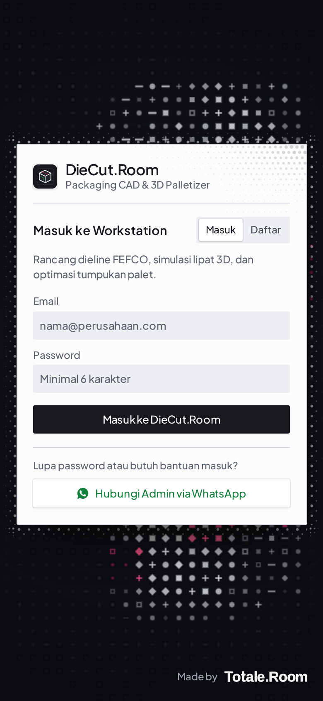 |
| **M2. Mobile 2D Die-Line CAD + Thumb Dock** | 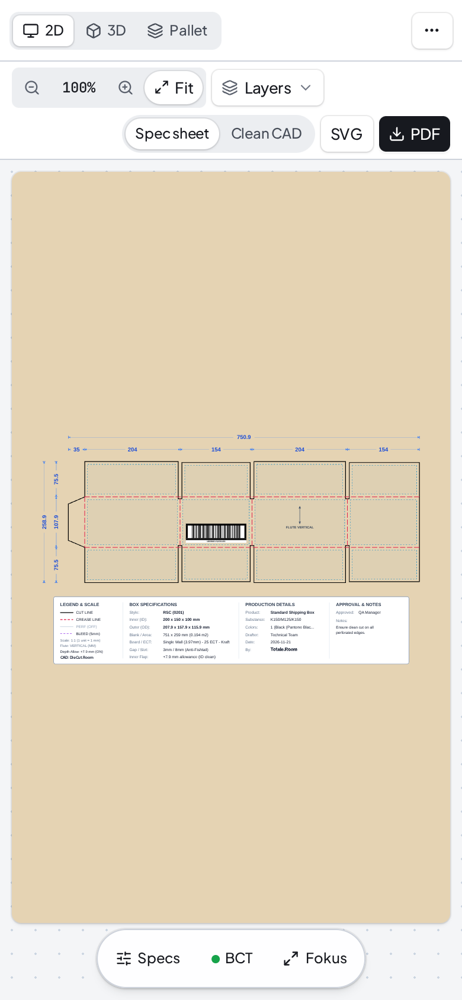 |
| **M3. Mobile Specs Slide-Over Drawer** | 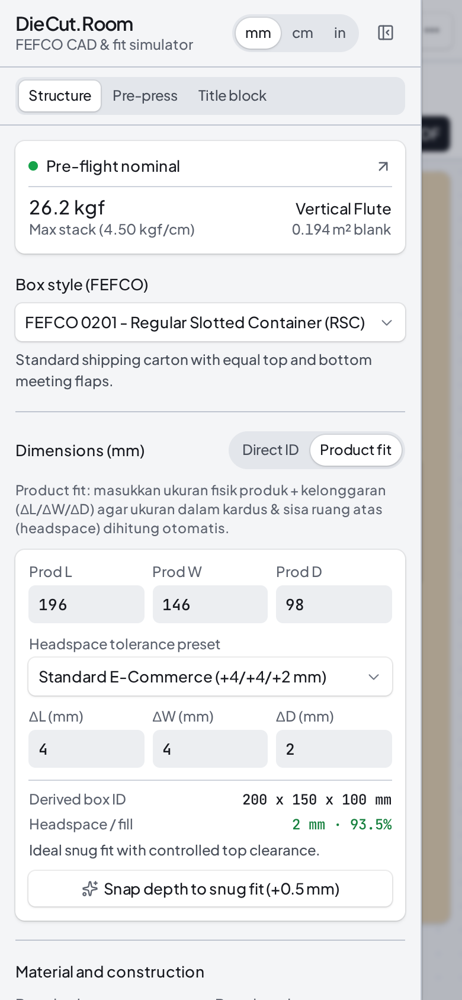 |
| **M4. Mobile 3D Fit & Tear Viewport** | 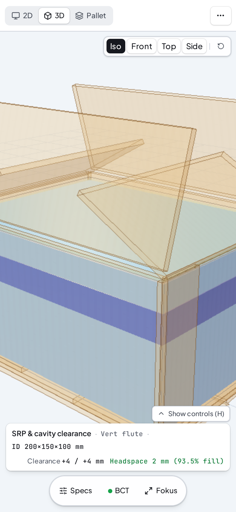 |
| **M5. Mobile Palletizer Pro 3D Viewport** | 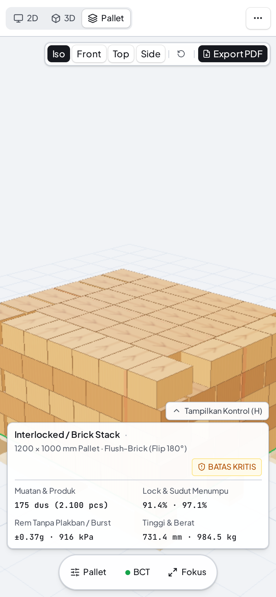 |
| **M6. Mobile BCT Pro Slide-Over Drawer** | 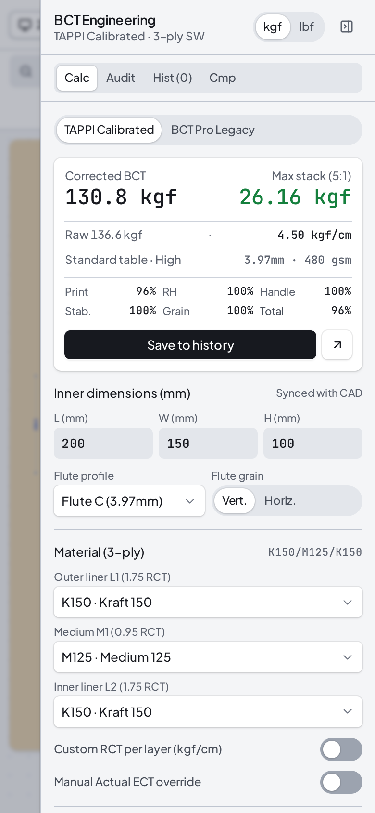 |

---

## Bagian 3 — Matriks Paritas Lengkap Seluruh State Aplikasi

| Modul / Layar | Seluruh State Aktual di Kode | Bukti Visual / Dokumentasi |
| :--- | :--- | :--- |
| **Bootstrap & Auth (`App.tsx`, `AuthGate.tsx`)** | Auth checking splash · Login · Register · Pending Approval · Account Disabled · Brute-Force Lockout · Hidden Admin Recovery (Recovery Key & SMTP OTP) | `01`–`03`, `m01` + `docs/01-USER-GUIDE.md` §1 |
| **Workspace Shell (`App.tsx`, `useWorkspaceLayout.ts`)** | 4-tier responsive (`desktop/compact/tablet/mobile`) · Short-Landscape HUD (`height ≤ 500px`) · Focus Mode (`F`/`Esc`) · Mobile Floating Thumb Dock · 3-unit switcher (`mm`/`cm`/`in`) | `04`, `m02`–`m06` + `DESIGN.md` §5 |
| **Specs Rail (`Sidebar.tsx`)** | Tab `Structure` (`Direct ID` / `Product fit`, FEFCO, Flute) · Tab `Pre-press` (Print boundaries, 13 SRP patterns) · Tab `Title block` (Metadata, ITF-14) | `04`–`06`, `m03` + `docs/01-USER-GUIDE.md` §3 |
| **2D Die-Line CAD (`BoxPreview.tsx`)** | Interactive Pan/Zoom · Layer visibility toggles · 1:1 mm SVG/PDF export (Clean CAD vs Spec Sheet) | `04`, `m02` + `docs/01-USER-GUIDE.md` §3 |
| **3D Fit & Tear (`Box3DViewer.tsx`)** | Fold presets (`Flat`/`Open`/`Closed` + `0–100%` slider) · X-Ray Cavity · POV Camera Capsule · SRP Tear (`0–100%` Peel/Reset) · WebGL Context-Lost recovery overlay | `07`–`08`, `m04` + `docs/01-USER-GUIDE.md` §4 |
| **Palletizer Pro 3D (`PalletizerWorkspace.tsx`)** | Normal Stack · Lock Heat-Map + L1/L2 Mini-Blueprint · Inspect Layer Slice · X-Ray · Perfectionist Tuning & Board Advice · Export PDF A4 Modal (2-Page Orthographic) | `09`–`12`, `m05` + `docs/01-USER-GUIDE.md` §5 |
| **BCT Pro Rail (`BCTInspectorRail.tsx`)** | Tab `Calc` (`TAPPI/ISO` vs `BCT Pro`, `kgf/lbf`) · Tab `Audit` (Board Advisor) · Tab `Hist` (SQLite log) · Tab `Cmp` (Multi-grade compare) | `04`, `13`–`15`, `m06` + `docs/01-USER-GUIDE.md` §6 |
| **Operational Modals** | `EngineeringSheet` (8 Pre-Flight rules + 1-click Auto-Fix + Costing) · `ProjectsModal` (Save/Load/Delete/Empty state) | `16`–`17` + `docs/01-USER-GUIDE.md` §7 |
| **Admin Console (`AdminUsersModal.tsx`)** | Tab 1 `Pengguna & Sesi` (Create/Edit/Bulk Approve/Revoke) · Tab 2 `Kesehatan & Prediksi` (Health Radar) · Tab 3 `Log Audit` · Tab 4 `Keamanan & Backup` (Password, Recovery Key, SMTP OTP, Agent/MCP Key, SQLite/JSON Backup) | `18`–`21` + `docs/01-USER-GUIDE.md` §2 |
