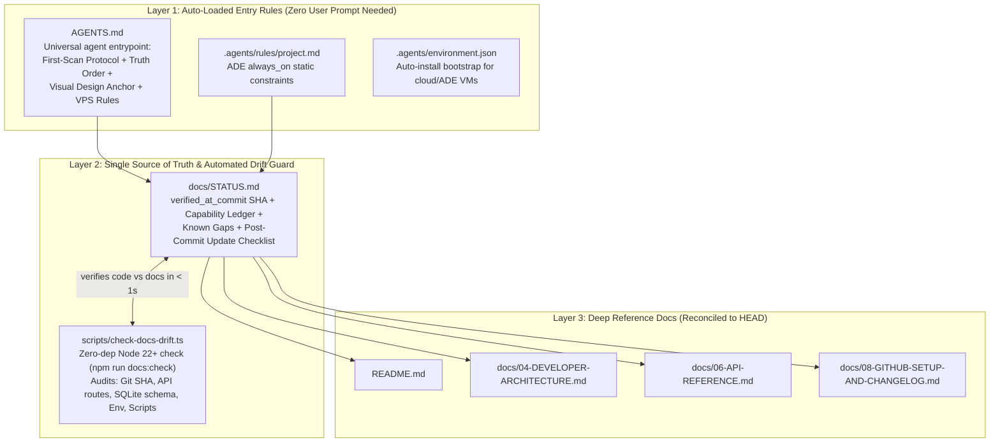

# Implementation Plan — Agent-First Documentation, Drift Detection & Environment Bootstrap

## Goal Description

Today, **DieCut.Room** has ~2,234 lines of detailed documentation ([README.md](file:///home/antigravity/totaleroom/diecutroom/README.md), [AGENTS.md](file:///home/antigravity/totaleroom/diecutroom/AGENTS.md), and `docs/01`–`08`), yet new AI agents and collaborators face three concrete problems when opening this repo without pasting custom onboarding prompts:

1. **No automatic first-scan anchor**: [AGENTS.md](file:///home/antigravity/totaleroom/diecutroom/AGENTS.md) is currently written purely as a Debian VPS deployment manual. It does not orient a coding agent to the codebase layout, the local dev/build workflow, or the visual design system (`tactile-design` + [src/index.css](file:///home/antigravity/totaleroom/diecutroom/src/index.css) + [TactileUI.tsx](file:///home/antigravity/totaleroom/diecutroom/src/components/tactile/TactileUI.tsx)).
2. **Silent documentation drift after commits**: Docs were last touched in commit `109e408` (Nov 17, 2026), while 3 major code commits (`9f5ef25`, `8be2ad4`, `d6ae118`) added Bearer token auth, 2 new SQLite tables (`system_meta`, `audit_logs`), ~25 new API routes (Admin Health Radar, Audit Logs, SMTP Email OTP, Recovery Keys, SQLite/JSON backups, Hermes Agent REST `/api/agent/*`, and MCP `/api/mcp`), `scripts/admin-reset.ts`, and `src/utils/lazyWithRetry.ts`. Because there is no `docs/STATUS.md` with a `verified_at_commit` SHA and no automated drift check, agents reading existing docs get outdated facts.
3. **No repeatable cloud/ADE installation bootstrap**: There is no `.agents/environment.json`, and [package-lock.json](file:///home/antigravity/totaleroom/diecutroom/package-lock.json) currently fails `npm ci --include=dev` on Linux x64 due to missing optional platform packages (`@esbuild/*`, `lightningcss-*`, `@rollup/rollup-*`, `fsevents`). When packages cannot install, any fallback preview cannot render your real React 19 + Tailwind + Tactile UI visual design.

This plan introduces a **lean, 3-layer agent-first documentation and drift system** that works automatically across IDEs/agents (ADE, Antigravity, Codex, Claude Code, Cursor, Gemini CLI) without requiring users to remember onboarding prompts, and stays accurate across future commits via a **zero-dependency Node 22+ drift checker** (`node scripts/check-docs-drift.ts`) that runs even without `node_modules`.



---

## User Review Required

> [!IMPORTANT]
> **Why your visual design couldn't render here (and what this plan can vs. cannot fix offline):**
> Adding `.agents/environment.json` lets any cloud/ADE VM with internet access to `registry.npmjs.org` automatically install React 19, Tailwind v4, Three.js, and Express on startup so the real app renders with your exact visual design. However, in this specific cloud sandbox where `registry.npmjs.org` returns `403 Forbidden`, automated install will only succeed after `registry.npmjs.org` is added to your environment's **Allowed Hosts** (or when run on a machine/VPS with npm access). Regenerating [package-lock.json](file:///home/antigravity/totaleroom/diecutroom/package-lock.json) to fix `npm ci` also requires one run with npm registry access.

> [!WARNING]
> **Preventing documentation bloat & future drift:**
> Instead of adding many new prose files that also go stale, this plan concentrates "current truth" in **one compact file** ([docs/STATUS.md](file:///home/antigravity/totaleroom/diecutroom/docs/STATUS.md)) backed by an automated zero-dependency checker ([scripts/check-docs-drift.ts](file:///home/antigravity/totaleroom/diecutroom/scripts/check-docs-drift.ts)). Existing `docs/01`–`08` remain deep reference guides and will be reconciled to `HEAD` (`d6ae118`) so there are zero contradictions on day one.

---

## Open Questions

Before executing, please confirm your preferences on these optional scope items:

1. **Multi-tool agent pointer (`GEMINI.md`)**: Should we add a thin 12-line `GEMINI.md` at repo root pointing to `AGENTS.md` and `docs/STATUS.md` (for Gemini CLI / tools that read `GEMINI.md`), or rely only on `AGENTS.md` + `.agents/rules/project.md`?
2. **Cloud/ADE auto-install (`.agents/environment.json`)**: Should we add `.agents/environment.json` running `npm install --include=dev --no-audit --no-fund` so future online cloud/ADE sessions auto-install dependencies before Turn 1? *(Note: we can switch it to `npm ci --include=dev` later once `package-lock.json` is regenerated with npm access.)*
3. **Small technical-debt cleanups found during audit**: Would you like these included in the same pass, or kept strictly documented as Known Gaps in `docs/STATUS.md`?
   - **a.** Copy `scripts/admin-reset.ts` into the runner stage of [Dockerfile](file:///home/antigravity/totaleroom/diecutroom/Dockerfile#L25-L27) so `npm run admin:reset` works inside Docker containers.
   - **b.** Remove the duplicate `agent/skills/tactile-design/` folder (keeping `.agents/skills/tactile-design/` as the single canonical copy).
   - **c.** Leave [metadata.json](file:///home/antigravity/totaleroom/diecutroom/metadata.json) untouched (if Google AI Studio still uses it) vs. updating its stale name/capability fields.
4. **Optional zero-install GitHub Action**: Should we add a lightweight `.github/workflows/docs-drift.yml` that runs `node scripts/check-docs-drift.ts` on pushes/PRs (uses built-in Node 22, zero `npm install`, warning-only by default so it never blocks urgent commits)?

---

## Proposed Changes

### Layer 1 — Auto-Loaded Entry Rules & Bootstrap (No User Prompt Required)

#### [MODIFY] [AGENTS.md](file:///home/antigravity/totaleroom/diecutroom/AGENTS.md)
Add a concise **Section 0 — First-Scan, Truth Order & Visual Design Protocol** at the very top (~25–30 lines) while preserving all existing Debian VPS sections (Sections 1–5) intact and fixing stale auth/env notes:
- **Truth order**: `Code & tests at HEAD` → `git diff <verified_at_commit>..HEAD` → `docs/STATUS.md` → `AGENTS.md` → `docs/*`.
- **Automatic First Scan** (runs in `< 5s`, zero `node_modules` needed):
  1. Read `docs/STATUS.md` and note `verified_at_commit`.
  2. Run `node scripts/check-docs-drift.ts` (`npm run docs:check`) to detect any code commits, routes, tables, or env vars newer than the docs.
- **Visual Design Fidelity Anchor**: Point every agent to `.agents/skills/tactile-design/SKILL.md`, [src/index.css](file:///home/antigravity/totaleroom/diecutroom/src/index.css), [src/components/tactile/TactileUI.tsx](file:///home/antigravity/totaleroom/diecutroom/src/components/tactile/TactileUI.tsx), and [public/assets/aistudio/](file:///home/antigravity/totaleroom/diecutroom/public/assets/aistudio) so UI work never drifts from the designed tactile studio aesthetic.
- **Post-Commit Hygiene**: Instruct agents that any commit changing routes, DB tables, env vars, scripts, or core features must update `docs/STATUS.md` (`verified_at_commit`) and pass `npm run docs:check`.
- **Update Section 1**: Add `npm run dev`, `npm run admin:reset`, `npm run docs:check`, explicit `Test: NOT PRESENT`, dual Cookie + Bearer token auth, and `ADMIN_RECOVERY_KEY` / `SMTP_*` / `MEMORY_LIMIT_MB`.

#### [MODIFY] [project.md](file:///home/antigravity/totaleroom/diecutroom/.agents/rules/project.md)
Refine the existing untracked `always_on` rule (keeping it ≤ 70 lines) so ADE/Antigravity agents automatically apply:
- **First-Scan rule**: Always read `docs/STATUS.md` and run `node scripts/check-docs-drift.ts` before trusting prose docs.
- **Visual Design rule**: Preserve exact tokens in `src/index.css`, primitives in `src/components/tactile/TactileUI.tsx`, and rules in `.agents/skills/tactile-design/SKILL.md`.
- **Static build/runtime guardrails**: Node 22+ native TS type-stripping in `server.ts` & `scripts/*.ts`, minimal `Dockerfile` runner deps (`express` + `dotenv`), `Test: NOT PRESENT`, protected `./data/` & `.env` paths.

#### [NEW] `GEMINI.md` *(if approved in Open Question 1)*
Thin 10–12 line pointer directing Gemini-based agents to read `AGENTS.md` + `docs/STATUS.md` and run `node scripts/check-docs-drift.ts` (zero duplicated rules).

#### [NEW] `.agents/environment.json` *(if approved in Open Question 2)*
```json
{
  "install": "npm install --include=dev --no-audit --no-fund"
}
```
Auto-installs dependencies on online cloud/ADE VMs before Turn 1 so Vite + React 19 + Tailwind v4 + Three.js render the exact visual design immediately.

---

### Layer 2 — Single Source of Truth (`docs/STATUS.md`) & Zero-Dependency Drift Detector

#### [NEW] `docs/STATUS.md`
Compact (~110–130 lines), scannable certification ledger anchored to a verified commit SHA:
```markdown
---
verified_at_commit: <HEAD_SHA_AT_VERIFICATION>
verified_at_date: 2026-11-20
app_version: 1.5.0
lint_and_build_status: UNVERIFIED_OFFLINE (registry.npmjs.org blocked in sandbox)
automated_tests: NOT PRESENT
---
```
Sections:
1. **Truth Order & Fast First-Scan** (exact 1-command check: `node scripts/check-docs-drift.ts`).
2. **Codebase & Entrypoint Map** (Backend `server.ts`, SPA `index.html → src/main.tsx → src/App.tsx`, Web Worker `src/workers/palletizer.worker.ts`, CLI `scripts/admin-reset.ts`, Drift check `scripts/check-docs-drift.ts`).
3. **Visual Design System Anchor** (`src/index.css` Precision Tactile Studio neutral tokens, `src/components/tactile/TactileUI.tsx`, `.agents/skills/tactile-design/SKILL.md`, Halftone Auth portal components, `public/fonts/` drop-in).
4. **Capability Ledger** (`IMPLEMENTED` / `NOT PRESENT` with exact file paths for 2D CAD, 13 SRP patterns, 3D Fit & Tear, Palletizer 3D + Worker, BCT Pro/TAPPI-ISO + Pre-Flight, Auth Cookie+Bearer+Recovery Key+SMTP OTP, 4-tab Admin Console, Health Radar/Audit/Backups, Hermes Agent REST `/api/agent/*`, MCP `/api/mcp`, PWA/Chunk Recovery).
5. **SQLite Schema & Runtime Env Summary** (5 tables: `users`, `bct_history`, `saved_projects`, `system_meta`, `audit_logs`; extra `users` columns `token_version`, `failed_login_count`, `locked_until`; all runtime/build env vars).
6. **Known Gaps & Technical Debt** (`package-lock.json` missing cross-platform optional deps for `npm ci`, `Dockerfile` runner stage `scripts/` status, `metadata.json` legacy fields, `test` script absent).
7. **Post-Commit Maintenance Protocol** (3-step checklist so future commits keep `verified_at_commit` fresh).

#### [NEW] `scripts/check-docs-drift.ts`
Zero-dependency Node.js 22+ TypeScript CLI (uses only `node:fs`, `node:path`, `node:child_process`, compatible with native Node type-stripping — runs in `< 1s` even with zero `node_modules`):
- **Check 1 — Git Commit Drift**: Extracts `verified_at_commit` from `docs/STATUS.md`; compares against `git rev-parse HEAD`; lists code-touching commits (`':!*.md' ':!docs'`) and changed files since `verified_at_commit`.
- **Check 2 — API Route Drift**: Scans all `app.(get|post|put|patch|delete|all)('/api/...')` definitions in [server.ts](file:///home/antigravity/totaleroom/diecutroom/server.ts) and verifies every route is documented in [docs/06-API-REFERENCE.md](file:///home/antigravity/totaleroom/diecutroom/docs/06-API-REFERENCE.md).
- **Check 3 — SQLite Schema Drift**: Scans all `CREATE TABLE IF NOT EXISTS <name>` and `ensureUsersColumn('<name>')` calls in [server.ts](file:///home/antigravity/totaleroom/diecutroom/server.ts) and verifies they appear in `docs/STATUS.md` and [docs/04-DEVELOPER-ARCHITECTURE.md](file:///home/antigravity/totaleroom/diecutroom/docs/04-DEVELOPER-ARCHITECTURE.md).
- **Check 4 — Env Var Drift**: Scans `process.env.<VAR>` in [server.ts](file:///home/antigravity/totaleroom/diecutroom/server.ts) (excluding internal platform vars `NODE_ENV`, `NGINX_PORT`, `DEFAULT_APP_PORT`, `DISABLE_HMR`) and checks coverage in [.env.example](file:///home/antigravity/totaleroom/diecutroom/.env.example) and `docs/STATUS.md`.
- **Check 5 — Scripts & Docker Parity**: Checks every `scripts` key in [package.json](file:///home/antigravity/totaleroom/diecutroom/package.json) is documented in `docs/STATUS.md`, and checks whether CLI scripts (`scripts/admin-reset.ts`) are copied in [Dockerfile](file:///home/antigravity/totaleroom/diecutroom/Dockerfile).
- Supports `--strict` flag (exits code `1` on drift) and default summary mode (prints clean status report).

#### [MODIFY] [package.json](file:///home/antigravity/totaleroom/diecutroom/package.json)
Add single script entry (no dependency changes):
```json
"docs:check": "node scripts/check-docs-drift.ts"
```

---

### Layer 3 — Reconcile Existing Docs & Configs to `HEAD` (`d6ae118`)

#### [MODIFY] [README.md](file:///home/antigravity/totaleroom/diecutroom/README.md)
- Update stale claims: dual HttpOnly `Partitioned` cookie + `Bearer` token auth, hidden Admin Recovery Key + SMTP Email OTP, 5-table SQLite schema (`system_meta`, `audit_logs`, plus `users` lockout/version columns), 4-tab Admin Console (Users, Health Radar, Audit Logs, Security/SMTP/Agent Key/Backups), Hermes Agent REST (`/api/agent/*`) + MCP (`/api/mcp`), `mm`/`cm`/`in` 3-unit workspace, `npm run admin:reset` & `npm run docs:check`.
- Add `docs/STATUS.md` at the top of the Complete Documentation Index.

#### [MODIFY] [docs/04-DEVELOPER-ARCHITECTURE.md](file:///home/antigravity/totaleroom/diecutroom/docs/04-DEVELOPER-ARCHITECTURE.md)
- Add schema definitions for `system_meta`, `audit_logs`, and `users` columns (`token_version`, `failed_login_count`, `locked_until`).
- Document `src/utils/apiSession.ts` (`authFetch` + Bearer token persistence) and `src/utils/lazyWithRetry.ts` (chunk-load error recovery).
- Link to `docs/STATUS.md` as the certified truth anchor.

#### [MODIFY] [docs/06-API-REFERENCE.md](file:///home/antigravity/totaleroom/diecutroom/docs/06-API-REFERENCE.md)
- Update Section 1 auth mechanism to cover both `Cookie: diecut_session` (`Partitioned`) and `Authorization: Bearer <token>`, plus `X-Agent-Key` / `Authorization: Bearer <agent_key>` for Agent/MCP routes.
- Document all ~25 routes added in `d6ae118`:
  - Admin recovery: `GET /api/auth/recovery-options`, `POST /api/auth/admin-recover`, `POST /api/auth/admin-recover/request-otp`, `POST /api/auth/admin-recover/verify-otp`
  - Admin user ops: `POST /api/admin/users`, `PATCH /api/admin/users/:id`, `POST /api/admin/users/bulk-approve`, `POST /api/admin/users/:id/revoke-sessions`
  - Admin security & ops: `POST /api/admin/security/change-password`, `POST /api/admin/security/rotate-recovery-key`, `GET/POST /api/admin/security/smtp`, `POST /api/admin/security/smtp-test`, `GET/POST/DELETE /api/admin/security/agent-key`, `GET /api/admin/health-radar`, `GET /api/admin/audit-logs`, `GET /api/admin/backup/sqlite`, `GET /api/admin/backup/json`
  - Agent & MCP: `GET /api/agent/skill`, `ALL /api/agent/connect`, `POST /api/agent/calculate`, `POST /api/agent/dieline`, `GET /api/agent/dieline/download`, `GET/POST /api/mcp`

#### [MODIFY] [docs/08-GITHUB-SETUP-AND-CHANGELOG.md](file:///home/antigravity/totaleroom/diecutroom/docs/08-GITHUB-SETUP-AND-CHANGELOG.md)
- Add an `Unreleased (post-v1.5.0)` changelog entry summarizing commits `9f5ef25`, `8be2ad4`, and `d6ae118`.

#### [MODIFY] [.env.example](file:///home/antigravity/totaleroom/diecutroom/.env.example)
- Add commented optional sections for `SMTP_HOST`, `SMTP_PORT`, `SMTP_SECURE`, `SMTP_USER`, `SMTP_PASS`, `SMTP_FROM`, and `MEMORY_LIMIT_MB` so runtime env vars in [server.ts](file:///home/antigravity/totaleroom/diecutroom/server.ts) have 100% template coverage.

---

## Verification Plan

### Automated Tests
Because `npm run lint` (`tsc --noEmit`) and `npm run build` require `node_modules` (currently blocked offline by `registry.npmjs.org` `403`), verification in this sandbox will run zero-dependency Node 24 checks:
1. **Run the drift detector in strict mode**:
   ```bash
   npm run docs:check -- --strict
   ```
   Verify exit code `0` with:
   - `0` undocumented `/api/*` routes from `server.ts`
   - `0` undocumented SQLite tables or `users` columns
   - `0` undocumented runtime env vars in `.env.example` / `docs/STATUS.md`
   - `0` undocumented `package.json` scripts
2. **Verify Node 22+ native TypeScript type-stripping** on `scripts/check-docs-drift.ts` and `scripts/admin-reset.ts`:
   ```bash
   node scripts/check-docs-drift.ts --help
   node scripts/admin-reset.ts --help
   ```
3. **Verify clean git diff scope** (`git status -sb` & `git diff --stat`) confirming zero unintended edits to CAD/3D/BCT/Palletizer source code, `./data/`, or `.env`.

### Manual Verification
1. Review `docs/STATUS.md` and `AGENTS.md` to confirm a brand-new agent opening the repo with **no custom prompt** immediately sees: what the app is, how to check drift in 1 command, where the visual design tokens/primitives live, and what is `IMPLEMENTED` vs `NOT PRESENT`.
2. When running later on a machine or online cloud VM with `registry.npmjs.org` access, run `npm install --include=dev && npm run lint && npm run build && npm run docs:check -- --strict` to confirm full TypeScript & Vite build health and regenerate `package-lock.json`.
